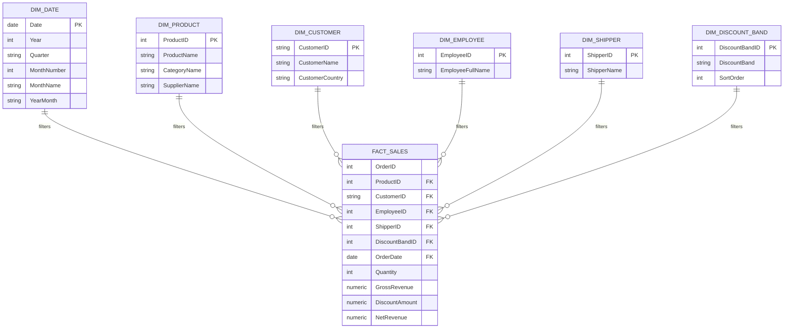

# Power BI Semantic Model Notes

The Power BI report uses `data/exports/sales_order_line_fact.csv` as its single
reporting source. The export is reproducible and is intentionally excluded from
Git because it is larger than GitHub's normal per-file limit.

## Reporting star schema

The report reshapes the central export into a star schema inside Power BI. All
relationships are one-to-many from a dimension to `FactSales`, with single
direction filtering toward the fact table. The `_Measures` table is disconnected
and exists only to organize DAX measures.



This diagram documents the reporting model for GitHub reviewers who cannot open
Power BI's Model view. The normalized transactional schema is documented
separately in [the source ER diagram](source_erd.md).

## Refresh workflow

Run the following commands from the repository root before refreshing Power BI:

```bash
python -m northwind_etl.pipeline
python -m northwind_etl.export_analytics
```

If the repository is moved to another computer, update the Power Query source
path so it points to the newly generated local CSV.

## Rolling 12-month definition

The recommended definition is the current month plus the preceding 11 complete
calendar months. Using month boundaries avoids a different result when the
latest source month contains only part of a month.

```DAX
Rolling 12M Net Revenue =
VAR LastVisibleMonth =
    EOMONTH ( MAX ( FactSales[OrderDate] ), 0 )
VAR FirstVisibleMonth =
    EOMONTH ( LastVisibleMonth, -12 ) + 1
RETURN
    CALCULATE (
        [Total Net Revenue],
        REMOVEFILTERS ( DimDate ),
        DATESBETWEEN (
            DimDate[Date],
            FirstVisibleMonth,
            LastVisibleMonth
        )
    )
```

For the unfiltered dataset, the benchmark for November 2022 through October
2023 is **$40,082,662.63**. The report should be checked against this value after
updating the measure.

## Validated report pages

| Page | Purpose |
|---|---|
| Executive Overview | Company-level KPIs, top products, top countries, and monthly revenue |
| Product & Market Performance | Category mix, product ranking, and revenue-versus-volume analysis |
| Operations & Discounts | Employee revenue, shipment performance, and discount-band analysis |
| Trends & Growth | Annual and monthly trends, growth rates, and rolling revenue |

All pages use synchronized Year, Country, and Category slicers.

